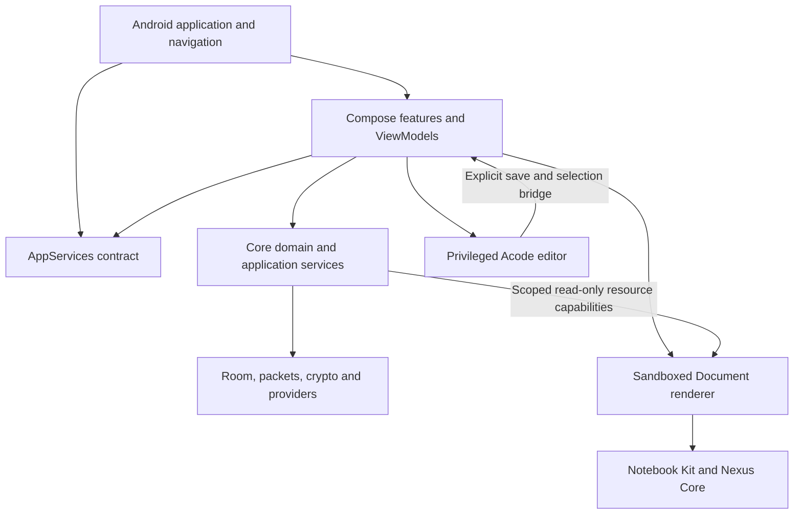

# Fieldfolio architecture

Fieldfolio has one Android Gradle module (`:app`) and one npm/Vite workspace (`acode-web`).
Android responsibilities are enforced through packages and executable source-boundary checks.
The package rules apply within that single Android module.

## Ownership and dependency direction

`MyApplication` constructs the service graph. Features resolve the `AppServices` interface in
`core/di`; they do not import the Android application class. Navigation registration stays in
`app/navigation`. Shared adaptive layout, image picking, back actions, path forms, strings and
clipboard helpers live below `core`, not inside a particular feature.

The automated rules reject core-to-feature/app dependencies, feature-to-composition-root
references, domain-to-UI/data dependencies, viewer-to-editor references, document state-to-view
references, duplicate declarations, mismatched package paths and unowned `GlobalScope` work.
They also bound production source and facade sizes. Feature-level integration is intentionally
allowed within the single Android module; model/report UI shares result and editor components.

## Report session

`feature/document/route` coordinates navigation, permissions, external pickers and retained
window state. It delegates rendering to editor/viewer packages. The report feed and toolbar
are separate components; editor forms do not live inside the route's rendering code.

`DocumentViewModel` owns one in-memory draft, private attachment bytes, navigation history,
model staging and pending exports. Its member methods remain the public screen contract.
Package-internal operation groups separate validated tree mutations, resource ownership, model
staging, runtime capabilities, persistence and cancellation-safe ZIP exports. They all use the
same ViewModel scope and state; they are not detached global services.

The same facade/operation pattern separates authentication credential/session/account/avatar
work and settings dialog/persistence/server-validation work. These operation groups share their owner
and mutable state; they do not construct independent screen sessions.

## Data invariants

- `DocumentTree` is an immutable ordered-tree transformer. Insert/update/transfer validate
  structure and normalize logical sibling names at the mutation boundary. UI text fields are
  not the only validation layer.
- `ResourceIdentity` separates a required logical name from an optional display title and
  visibility/title presentation. The viewer filters invisible or visually empty subtrees.
- `ReportLibrary` owns report VFS persistence, access control and report packets. It serializes
  operations through its access boundary and retains explicit database migrations.
- Resources belong to report packets. Text edits operate on owned copies. Model results retain
  complete result/input/mask metadata rather than a live dependency on an imported model.
- Report archives may be protected; selected element/subtree and standalone analysis exports
  are plain ZIP snapshots. Widget exports use available snapshots, not surprise permission/network calls.
- Room uses schema **9** with explicit migrations. The current schema is exported under
  `app/schemas` for migration review.

## Web trust boundary

The Acode editor and executable Document runtime are different WebViews and module graphs.
The trusted editor receives the narrowly scoped `NativeEditor` bridge. Document source is inert
in that editor. The document renderer is a sandboxed iframe with an opaque origin, an exact
per-runtime resource origin/capability path, blocked file/content access and no native bridge.
External imports, persistent DOM storage, workers, downloads and pop-up dialogs are restricted.

A Document reads typed report elements by logical names through `Folio.vfs`; cover art is a field
of the report/audio owner. It has no write, rename, move, delete, filesystem or native-model-run API.
Presentation visibility is not a resource access-control boundary within the same unlocked report.
Locking revokes the runtime and private capabilities. Arbitrary notebook code can still consume
its renderer's CPU/memory; the sandbox is not a resource-quota system.

Rendered HTML and read-only Acode share one query model/panel with content-specific adapters.
The renderer reuses Acode's draggable scrollbar. Mini preview is not scrollable. Search, viewport,
Nexus state and form state are memory-owned for the live session, not promised after process death.

## Lifecycle and threading

Private drafts do not enter `SavedStateHandle` or Android saved-state bundles. Opaque window/slot
identifiers may be saved; `SessionStateViewModel`, report-owned media/window state and the bounded
WebView pool survive configuration changes. Audio ownership and waveform caching are separate
from recycled feed cells. Camera, crop and analysis frames retain original/run/current geometry.

Coroutines follow ViewModel/report owners. Persistence, ZIP/media IO and inference use the
existing IO/default boundaries; exported data uses immutable snapshots. UI structure changes
must preserve cancellation, lock revocation and final-save behavior. Tests exercise nested Acode
saves, rotation, private state, archive selection and model/result projection contracts.

See the [component map](docs/architecture/MAP.md), [decisions](docs/architecture/DECISIONS.md) and
[validation evidence](docs/VALIDATION.md) for concrete files and limits of the checks.
