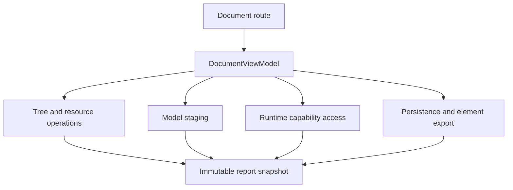

# Architecture map

Paths below are relative to the repository root. Android package paths are relative to
`app/src/main/kotlin/com/karandaev/fieldfolio/`. Tests mirror the production packages under
`app/src/test/kotlin/`; device-only checks are under `app/src/androidTest/kotlin/`.

## Android components

| Location | Responsibility | Ownership / boundary |
|---|---|---|
| `app/` | Activity, application startup, scaffold, navigation registration | Composition root; constructs services and connects feature routes |
| `core/di/AppServices.kt` | Interface for application-owned dependencies | Features depend on the interface, never on `MyApplication` |
| `feature/library/` | Reports VFS, destination/path forms, selection and report actions | Delegates persistence/access checks to `core/library` |
| `feature/document/route/` | Report route coordination, permissions and nested windows | Coordinates one report session rather than implementing element forms |
| `feature/document/state/` | Draft, pending edits/exports, model staging and viewer window identity | Lifecycle owners and package-internal operation groups |
| `feature/document/editor/` | Ordered report VFS, element properties and editable previews | Calls the shared tree/resource operations; does not write original device files |
| `feature/document/viewer/` | Report feed, typed cards, text/media/model windows | Read-only presentation; cannot import editor screens |
| `feature/document/components/` | Shared document toolbar and presentation controls | Reused by route/editor/viewer |
| `feature/models/` | Catalog, model configuration and standalone analysis workspace | Distinguishes built-in/imported local models from server adapters |
| `feature/detection/` | Image acquisition and detection pipeline integration | Facade and input/pipeline/message operation files share one owner |
| `feature/auth/`, `feature/profile/` | Account/session screens and profile operations | Firebase/Google implementations remain in core |
| `feature/settings/` | Appearance, text/audio options, server settings, reset | One state owner; dialog, persistence and network-validation operation groups |
| `feature/map/`, `feature/weather/`, `feature/weathercard/` | Map/location state and reusable weather/clock UI | Camera/state is not re-created merely because a feed cell is recycled |
| `feature/home/` | Current Reports entry route and retained reusable home components | Unregistered historical home/create/view screens have been removed |
| `core/document/` | Ordered immutable tree, typed report blocks, presentation rules, paths, text/media metadata, crop/result geometry and element ZIPs | Common mutation and serialization invariants below UI |
| `core/document/runtime/` | Document WebView clients/pool and read-only resource capabilities | Revocable per-report runtime, no native mutation bridge |
| `core/library/`, `core/names/`, `core/security/` | Report packets/VFS access, sibling naming, passwords and protection | Enforces contracts independently of text fields |
| `core/models/`, `core/inspectionapi/` | Model catalog, adapters, inference and result contracts | Keeps input/output snapshots usable without a live imported model |
| `core/domain/`, `core/data/`, `core/json/` | Domain models/repository interfaces, Room implementations and serialization | Domain cannot depend on UI or persistence implementations |
| `core/image/`, `core/audio/` | Acquisition, crop/cache/validation and audio ownership | Shared by normal media and model input flows |
| `core/location/`, `core/weather/`, `core/network/` | Platform/network providers | IO and permission boundaries remain explicit |
| `core/state/`, `core/ui/`, `core/localization/` | Shared preferences, lifecycle/layout/scroll/dialog/text helpers and localization | No dependency on app or feature implementations |
| `acode/` | Native editor bridge, settings and read-only/editor WebView integration | Privileged editor host; separate from executable Document runtime |

## State operations

`DocumentTreeActions`, `DocumentResourceActions`, `DocumentModelActions`,
`DocumentRuntimeAccess`, `DocumentPersistence` and `DocumentElementExport` are internal
extensions of the same owner. They do not construct extra ViewModels or scopes. The same
pattern applies to `AuthViewModel`, `SettingsViewModel` and `DetectViewModel`.

## Web workspace

| Location | Responsibility |
|---|---|
| `acode-web/src/editor/` | Editor entry, native document synchronization, editing/read-only modes |
| `acode-web/src/acode/host/` | Adapted editor search, selection, completion, scrolling and host helpers |
| `acode-web/src/document/` | Sandboxed Notebook Kit renderer, VFS adapters, theme and transport |
| `acode-web/src/search/` | Shared search query/panel with editor and DOM adapters |
| `acode-web/vendor/` | Pinned Notebook Kit and Nexus source packages |
| `acode-web/third_party/` | Acode/upstream license and font notices |
| `acode-web/scripts/` | Canonical help synchronization and source/output asset manifest |
| `docs/api/` | Human-maintained English/Russian Document API documentation |
| `app/src/main/assets/{acode,document,help}/` | Current generated assets, shipped for Android-only builds |
| `app/src/main/assets/web-assets.json` | Input/output SHA-256 inventory; checked before distribution |

The document dependency graph is tested independently: it may import the shared scrollbar,
but cannot import editor entry points, privileged host modules or `NativeEditor`.

## Repository automation

| Location | Contract |
|---|---|
| `scripts/architecture/check.py` | Package direction, source paths, duplicate declarations, size and coroutine rules |
| `scripts/check_repository.py`, `scripts/package_source.py` | Public-source inventory and complete deterministic source export |
| `scripts/format_kotlin.py` | Checksum-pinned ktfmt 0.55 Google style |
| `scripts/check_web_assets.py` | Reject stale or missing bundled web assets |
| `scripts/testing/` | Verified Robolectric SDK bootstrap and opt-in test-only network guard |
| `scripts/release/` | Version/tag matching and scoped release credential preparation |
| `tests/` | Python architecture mutation tests and release/distribution contracts |
| `.github/workflows/ci.yml` | Source/web checks, Android tests, lint and debug APK |
| `.github/workflows/release.yml` | Verified tag APK artifact; optional manually requested signed draft release |
| `app/schemas/` | Room schema snapshots, currently version 9 |

For tradeoffs see [Decisions](DECISIONS.md); for measured checks see [Validation](../VALIDATION.md).
