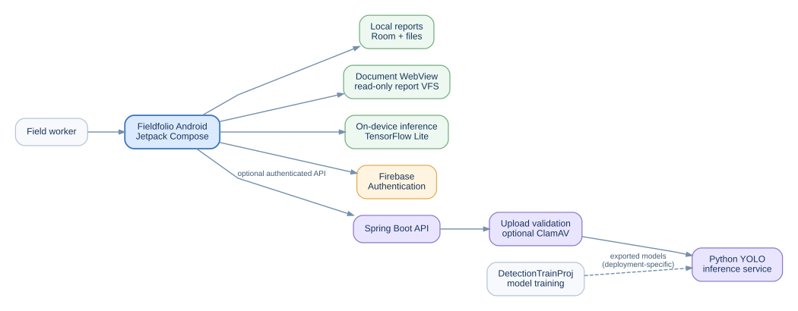

# Fieldfolio

Fieldfolio is an Android workspace for field reports. A report combines ordered text,
photos, audio, locations, weather, clocks, model results and interactive Document elements.
Reports are stored on the device; the optional backend provides authenticated remote image
analysis and profile avatars.

[Русское описание](README.ru.md) · [Documentation](docs/README.md) ·
[Installation](INSTALL.md) · [Architecture](docs/ARCHITECTURE.md)



## Workspaces

| Directory | Responsibility | Start here |
|---|---|---|
| `MobileApp/` | Android client, local reports, TFLite and WebView frontend | [App guide](MobileApp/README.md) |
| `Server/` | Spring Boot API, Firebase verification, avatars and image validation | [Server setup](Server/README.md) |
| `Server/python-yolo/` | FastAPI inference worker used by the Java server | [Inference worker](Server/python-yolo/README.md) |
| `DetectionTrainProj/` | VOC dataset conversion, YOLO training, validation and export | [Training guide](DetectionTrainProj/README.md) |

Each workspace has its own build or Python environment. Training is not part of the Android
build, and the Android report library is not synchronized to PostgreSQL by the backend.

## Build the Android app

Install JDK 17, Android SDK platform 36 and build-tools 35.0.0. Open **`MobileApp/`** in
Android Studio, or run from the repository root:

```sh
cd MobileApp
./gradlew :app:assembleDebug
```

PowerShell uses `.\gradlew.bat :app:assembleDebug`. Output:
`MobileApp/app/build/outputs/apk/debug/app-debug.apk`.

The checkout includes generated WebView assets and the built-in TFLite model. Node is needed
when rebuilding the frontend. Guest/local reports do not require Firebase credentials.
Real account features require `MobileApp/app/google-services.json` for the app's Firebase
project. See [build modes and signing](MobileApp/docs/BUILDING.md).

## Use reports

Create a report in the library, add elements and folders, then save the report. Logical names
address resources; display titles control presentation. Document elements execute notebook
cells in an isolated reader with read-only access to that report's resources.

- [User guide in Russian](docs/USER_GUIDE.ru.md)
- [Document API EN](MobileApp/docs/api/document-en.md) / [RU](MobileApp/docs/api/document-ru.md)
- [Data formats and protection](MobileApp/docs/DATA_FORMATS.md)
- [Models and result snapshots](MobileApp/docs/MODELS.md)

## Run remote analysis

The Java API needs PostgreSQL, a Firebase Admin service account and a reachable inference
worker. TLS, process management and ClamAV are configured independently.
Follow [Server setup](Server/README.md), then verify the request examples in
[HTTP API](Server/docs/API.md). `/public/health` reports backend reachability;
`/health` on the Python worker reports that worker separately.

## Develop and release

- [Build and test commands](docs/BUILD_AND_TEST.md)
- [CI and tag behavior](docs/WORKFLOWS.md)
- [Signed Android releases](MobileApp/docs/RELEASING.md)
- [Troubleshooting](docs/TROUBLESHOOTING.md)
- [Contributing](CONTRIBUTING.md) and [security](SECURITY.md)

Fieldfolio-authored Android code is covered by [its MIT license](MobileApp/LICENSE.md).
Preserve [third-party notices](MobileApp/THIRD_PARTY_NOTICES.md); model weights have separate
[provenance information](MobileApp/docs/MODEL_PROVENANCE.md).
