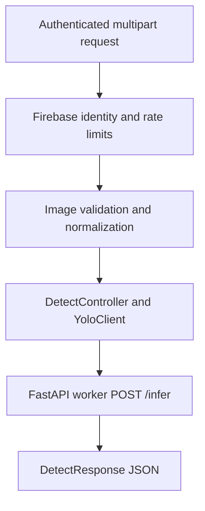

# Server architecture

## Image request

`ImageValidationService` checks byte count, invokes the configured antivirus scanner,
detects the real format, probes dimensions, checks geometry, decodes and re-encodes the image.
`DetectController` passes normalized bytes to `YoloClient` and returns image dimensions,
format and detections. `YoloHttpClient` sends raw bytes, not multipart, to the worker.

The worker loads its model during module import and calls `predict` with `imgsz=768`,
`conf=0.25`, `iou=0.45` and `max_det=300`. Java adds normalized image metadata to the response.

## Ownership and sources

| Source below the Java package root | Responsibility |
|---|---|
| `App.java` | Boot startup and configuration properties |
| `web/` | Health, identity and detection request adapters |
| `security/` | Firebase initialization/filter/provider and route authorization |
| `ratelimit/` | UID/IP keys, rule resolution and token buckets |
| `image/`, `service/ImageValidationService.java` | Image checks, scanner, normalization |
| `yolo/http/` | HTTP client and timeout |
| `yolo/process/` | Optional Python process lifecycle |
| `profile/` | Profile metadata and avatar files |

The Java package root is `src/main/java/com/karandaev/roadCrackDetectionServer/`.
Worker source is `python-yolo/app.py`. Runtime configuration examples are under
`config/` and `src/main/resources/application_stripped.yml`.

## Persistence and service boundaries

PostgreSQL persists user profile metadata; avatar bytes live in the configured directory.
They must be backed up consistently. Android reports and their attachments remain in the
client's local library and are not synchronized by this server.

The Java process can start/stop the worker and clamd when enabled. External service management
is also supported by disabling the corresponding managed-process setting. The worker endpoint
has no Firebase guard; restrict direct access. `/public/health` reports Java reachability,
while worker `/health` is a separate endpoint. Neither substitutes for a successful image request.
