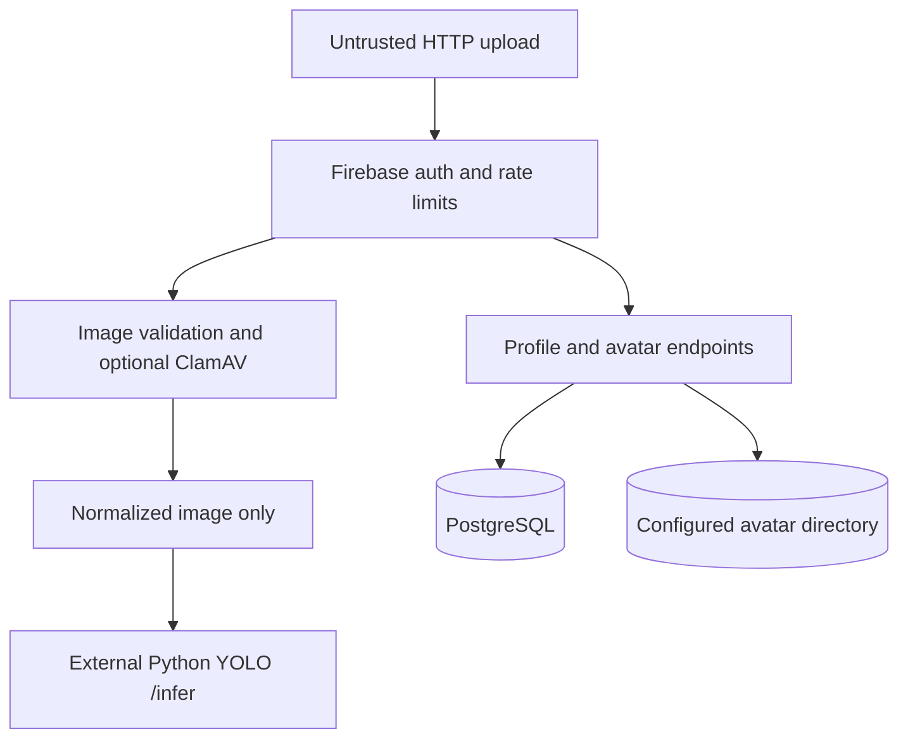

# Server architecture

## Request path

```mermaid
sequenceDiagram
    participant A as Android client
    participant Sec as Firebase/Spring Security
    participant API as DetectController
    participant Scan as ImageValidationService
    participant YOLO as YoloHttpClient
    participant PY as Python inference service
    A->>Sec: POST /v1/detect with Firebase ID token and file
    Sec->>Sec: Verify token, email and rate limits
    Sec->>API: Authenticated request
    API->>Scan: Uploaded bytes
    Scan->>Scan: Size, format and dimensions; optional antivirus; normalization
    Scan-->>API: SafeImage
    API->>YOLO: Normalized bytes
    YOLO->>PY: POST /infer
    PY-->>YOLO: YOLO detections
    YOLO-->>API: Inference result
    API-->>A: DetectResponse JSON
```

## Source map

| Source | Responsibility |
|---|---|
| `App.java` | Spring Boot startup, configuration property registration |
| `web/DetectController.java` | `/v1/detect` request adapter |
| `web/HealthController.java` | Public health timestamp |
| `web/MeController.java` | Authenticated identity endpoint |
| `security/` | Firebase filter/provider, email verification and authorization |
| `ratelimit/` | Request accounting and policy filters |
| `image/`, `service/ImageValidationService.java` | Format and size validation, normalization, antivirus integration |
| `yolo/http/YoloHttpClient.java` | HTTP request to external inference service |
| `yolo/process/YoloProcessManager.java` | Optional managed Python inference process lifecycle |
| `profile/` | Avatar endpoint, storage and persistence |
| `src/main/resources/application_stripped.yml` | Sanitized configuration example; **not** active `application.yml` |

Paths above are relative to `Server/src/main/java/com/karandaev/roadCrackDetectionServer/`,
except the resources path. Database and avatar storage support profile data; they do not
store the Android report library.

## Trust boundaries



`/public/health` is intentionally public and returns a basic status, not a full dependency
health check. The Python process can be managed by Java when configured; this does not mean
training code is automatically deployed. No tests were present in the supplied Server.zip.
