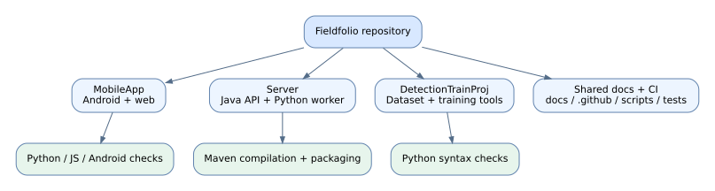

# System architecture

Fieldfolio has three build workspaces and two backend processes. Android owns local reports
and model snapshots. Spring Boot provides the authenticated public API. A separate FastAPI
worker runs YOLO. The training workspace prepares datasets and weights for deployment.

## Data ownership

| Data | Owner | Persistence |
|---|---|---|
| Report hierarchy and access metadata | Android `ReportLibrary` | Room library nodes/state |
| Document elements and attachments | Android report packets | App-private object files |
| Settings and remembered app state | Android repositories | Room |
| Imported local models | Android `ModelCatalog` | `model_catalog/` and catalog metadata |
| Interactive Document state | Active report runtime | Memory during the live session |
| User profiles | Java API | PostgreSQL/JPA |
| Avatars | Java API | Configured directory plus profile metadata |
| Inference weights | Python worker | `best_models/best.pt` relative to worker working directory |
| Training data, runs and exports | Training workspace | Local dataset/output directories |

The backend does not store or synchronize the Android report library. A saved model result
contains a snapshot and its resources; it is not a live reference to the training process.

## Request flow

1. Android chooses a local catalog model or a registered server adapter.
2. Local execution uses TFLite and produces `ModelResultData`.
3. Remote execution sends multipart image data and a Firebase ID token to `/v1/detect`.
4. Spring Security validates identity/email and applies rate limits.
5. The image pipeline checks bytes, antivirus policy, format and dimensions, then normalizes.
6. Java sends raw normalized bytes to the worker's `/infer` endpoint.
7. Android maps detections to the common result representation and can save them in a report.

## Interactive Document boundary

Acode edits notebook source as text. A separate sandboxed WebView executes the Document.
It has no native editor bridge, report mutation API or direct app filesystem access. Its VFS
capabilities are scoped to one report/runtime and revoked when that report is locked.
Native services coordinate existing location/weather data; a VFS read does not grant a
Document authority to start arbitrary network or permission requests.

## Build ownership

See the [Android architecture](../MobileApp/ARCHITECTURE.md),
[server architecture](../Server/docs/ARCHITECTURE.md) and
[training pipeline](../DetectionTrainProj/docs/TRAINING_AND_EXPORT.md) for code-level details.
Editable diagram sources are the `.dot` files next to their SVG outputs.
