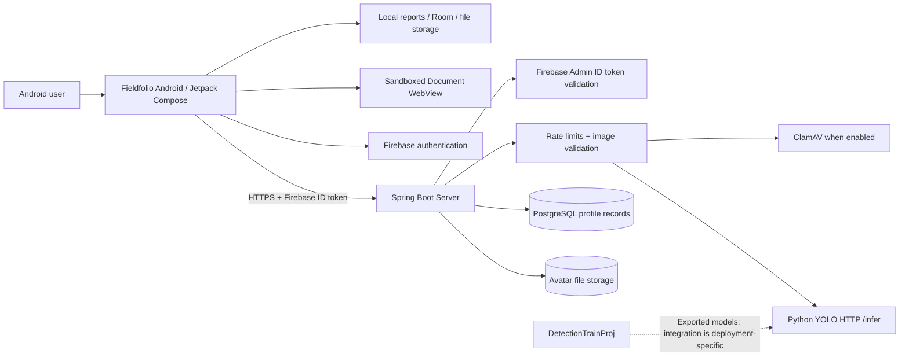
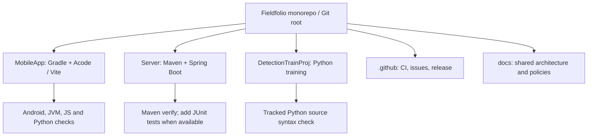

# Fieldfolio architecture

The repository is a **monorepo, not a single build**. Android is built with Gradle; the
Spring Boot API with Maven; the training workspace has its own Python requirements.

## Runtime overview

The client supports both on-device TFLite models and optional server-side detection. The
interactive Document renderer has a scoped, read-only report VFS; it does not gain access
to server credentials or the native editor bridge. Backend authentication and profile storage
are separate from local report persistence.

## Repository layout

## Key source paths

- Android service graph: `MobileApp/app/src/main/kotlin/com/karandaev/fieldfolio/app/MyApplication.kt`.
- Android Document VFS and WebView: `MobileApp/app/src/main/kotlin/com/karandaev/fieldfolio/core/document/`.
- Web editor and notebook runtime: `MobileApp/acode-web/src/editor/` and `src/document/`.
- Spring Boot entry: `Server/src/main/java/com/karandaev/roadCrackDetectionServer/App.java`.
- HTTP endpoints: `Server/src/main/java/com/karandaev/roadCrackDetectionServer/web/` and `profile/web/`.
- Server image security: `Server/src/main/java/com/karandaev/roadCrackDetectionServer/image/`.
- Server inference adapter: `Server/src/main/java/com/karandaev/roadCrackDetectionServer/yolo/`.

## Boundaries and limitations

- `Server.zip` contains Spring Boot source, but not the `Server/python-yolo` implementation,
  PostgreSQL deployment, signing certificates, or a runnable production config.
- The training workspace was described by its directory tree only; we do **not** claim its
  models are directly deployable to the server without a separate export/configuration step.
- A passing Android build and `mvn verify` do not test the end-to-end TLS, Firebase, ClamAV,
  database and YOLO pipeline. Deploy those dependencies in a separate integration environment.
